


 



 




 


  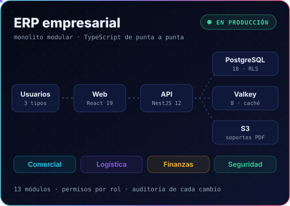
  <a href="https://github.com/EvoShell/FORECASTING-ECG"></a>

  <b>ERP</b> · código privado, en producción
  &nbsp;&nbsp;│&nbsp;&nbsp;
  <b>FORECASTING-ECG</b> · <a href="https://ecg-forecasting.vercel.app">tablero en vivo</a> · <a href="https://evoshell-api-ecg-forecasting.hf.space/docs">API de inferencia</a> · <a href="https://github.com/EvoShell/FORECASTING-ECG">repositorio</a>

 



 


  
  <a href="https://www.credly.com/badges/af00265f-49e7-4211-a40a-749441694eab/public_url"></a>
  <a href="https://www.credly.com/badges/bce3c3dd-1d67-44f6-b998-4dfe9fa4271d/public_url"></a>

 


  
  

<picture>
  <source media="(prefers-color-scheme: dark)" srcset="https://raw.githubusercontent.com/EvoShell/EvoShell/output/snake-dark.svg"/>
  <source media="(prefers-color-scheme: light)" srcset="https://raw.githubusercontent.com/EvoShell/EvoShell/output/snake.svg"/>
  
</picture>

  

<a href="mailto:evos.sys@gmail.com"></a>

Los trazos de ECG de este perfil son señal real: registro 100 de la <a href="https://physionet.org/content/mitdb/1.0.0/">MIT-BIH Arrhythmia Database</a> (Moody y Mark, 2001), PhysioNet, licencia ODC-BY 1.0.

